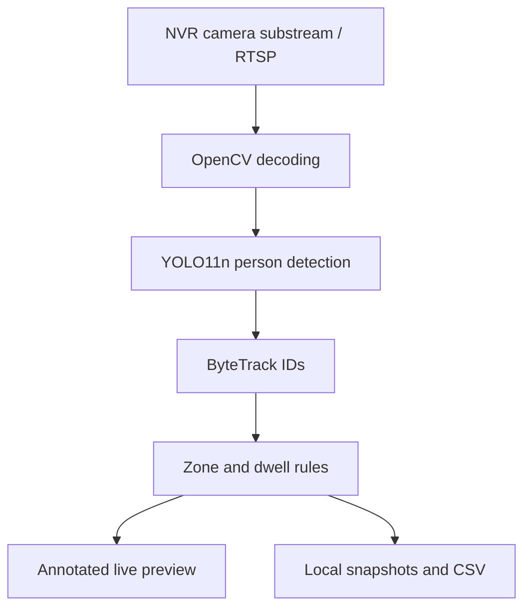

# Real-World CCTV Anomaly Detection

**Local CCTV video analytics with Python, YOLO11, ByteTrack and OpenCV.**

Developed by [Dr. Muhammad Asif](https://github.com/asif3252), this project explores restricted-area intrusion and loitering detection using existing NVR infrastructure.

> **Status: single-camera research prototype.** Two alert-rule unit tests pass. Live NVR integration, detection accuracy and multi-camera capacity remain unvalidated. This project does not claim production readiness or general recognition of arbitrary abnormal behavior.

## Features

| Capability | Implementation |
|---|---|
| Video input | Dahua-style RTSP substream, selectable NVR channel |
| Person detection | Pretrained YOLO11n, CPU inference |
| Tracking | ByteTrack IDs across consecutive frames |
| Restricted area | User-drawn rectangle |
| Intrusion | At least 2 seconds of continuous observed presence |
| Loitering | User-selected continuous dwell threshold; default 30 seconds |
| Alert suppression | 60-second cooldown per event type and active track |
| Evidence | Annotated JPEG snapshots and timestamped CSV logs |
| Credentials | Local dialogs; not intentionally saved to files |

Zone membership uses the bottom-center of a person's bounding box. Alerts are explicit rules applied to detected people, not predictions from a trained general anomaly classifier.

## Architecture



SmartPSS viewing and NVR recording operate independently. The application reads a stream; it does not modify NVR settings or inject SmartPSS alarms.

## Windows quick start

Install Python 3.11 or 3.12 with tkinter and the Python launcher, then:

```powershell
git clone https://github.com/asif3252/real-world-cctv-anomaly-detection.git
cd real-world-cctv-anomaly-detection
powershell -ExecutionPolicy Bypass -File .\Start.ps1
```

The execution-policy option applies to this process. The launcher creates a virtual environment and installs dependencies. First run downloads YOLO11n weights. Internet is needed for downloads; video inference runs locally.

Manual setup:

```powershell
py -3 -m venv .venv
.\.venv\Scripts\python.exe -m pip install -r requirements.txt
.\.venv\Scripts\python.exe app.py
```

1. Enter the local NVR IP/hostname and actual RTSP port, commonly 554.
2. Select a connected channel and enter credentials privately in the local dialogs.
3. Choose a loitering threshold.
4. Draw a restricted-area rectangle and press **Enter**.
5. Press **R** to redefine the area or **Q** to stop.

Use the same LAN as the NVR. SmartPSS port 37777 differs from the RTSP port. The application requests substream 1; enable a usable substream for the channel.

## Event output

The ignored `events/` directory contains snapshots and `events.csv`.

| CSV field | Meaning |
|---|---|
| time | Local timezone-aware timestamp |
| channel | Selected NVR channel |
| event | intrusion or loitering |
| track_id | Temporary tracker ID, not personal identity |
| dwell_seconds | Continuous observed time in the zone |
| snapshot | Saved JPEG filename, or WRITE_FAILED |

Keep event evidence private and monitor disk usage; automatic retention is not implemented. No camera footage, credentials or deployment addresses are distributed here.

## Tests and evaluation

Rule tests do not require OpenCV or model downloads:

```powershell
py -3 -m unittest discover -s . -p test_events.py
```

Tests cover persistence, dwell thresholds, cooldown, state reset after leaving and separation between track IDs. Passing these tests establishes rule behavior only.

For live evaluation, measure event precision/recall, false alerts per camera-hour, end-to-end alert delay, CPU/RAM use and stream freshness against manually labeled events. See [the validation plan](VALIDATION.md).

## Limitations

- One camera per process; capacity for 25 cameras has not been benchmarked.
- Small people, occlusions, camera angle and low light affect detection.
- Missed detections reset dwell; ID switches can interrupt dwell or cause repeat alerts.
- A processing gap over five seconds resets rule state. Buffered video can still delay alerts.
- Displayed FPS is loop throughput, not end-to-end latency.
- Stream failure stops detection; no automatic reconnection.
- No event clips, remote notifications, schedules, fall/fight detection or SmartPSS alarm injection.
- No published live accuracy, FPS or reliability results.

## Roadmap

- [ ] Validate a single camera using labeled events.
- [ ] Add bounded buffering and automatic reconnection.
- [ ] Add saved polygon zones and schedules.
- [ ] Add event clips and retention controls.
- [ ] Benchmark OpenVINO and multi-camera scheduling.
- [ ] Investigate temporal anomaly models against a documented baseline.

## Contributing

Bug reports, tests and reproducible benchmarks are welcome. Read [CONTRIBUTING.md](CONTRIBUTING.md). Share only authorized or synthetic media, and remove camera credentials and site details.

## Dependencies and licensing

Uses Ultralytics, OpenCV and Python's standard library. Weights download separately and are not redistributed. Review [Ultralytics licensing](https://www.ultralytics.com/license) and dependency terms before redistribution or commercial integration. No additional license grant is supplied for this repository's original source at this stage.

## Author

**Dr. Muhammad Asif — AI, computer vision and cybersecurity researcher/developer.**

[GitHub](https://github.com/asif3252) · [Google Scholar](https://scholar.google.com/citations?user=YEK68gYAAAAJ&hl=en)

## Technical references

- [Dahua RTSP format](https://www.dahuawiki.com/Remote_Access/RTSP_via_VLC)
- [Ultralytics YOLO11](https://docs.ultralytics.com/models/yolo11/)
- [Ultralytics tracking](https://docs.ultralytics.com/modes/track/)

